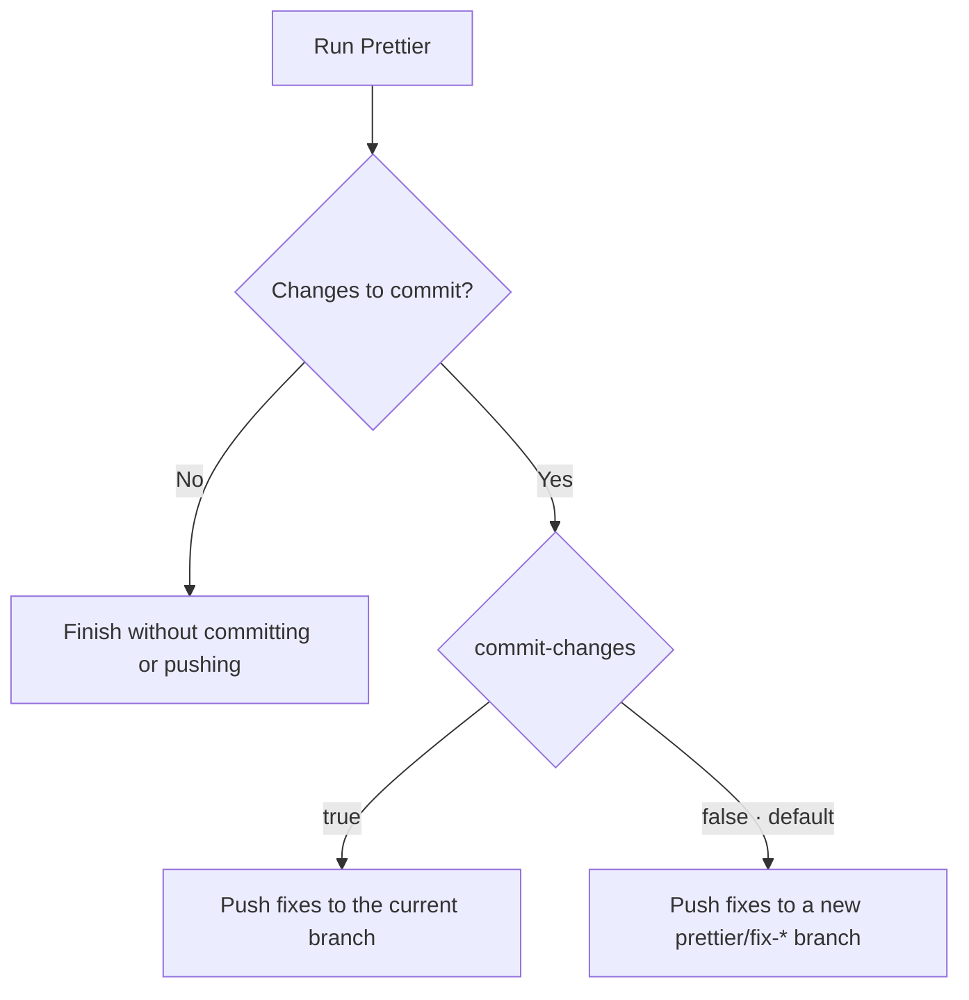

# Prettier-Fix

Prettier-Fix is a GitHub Action that runs [Prettier](https://prettier.io/), commits formatting fixes, and pushes them to GitHub. Run it before [Super-Linter](https://github.com/super-linter/super-linter) so formatting fixes are applied before linting.

  

## Features

- **Automatic formatting.** Apply Prettier fixes in CI so contributors spend less time on formatting during code review.
- **Review fixes or push directly.** By default, the action pushes fixes to a new `prettier/fix-*` branch for review. Start there, then set `commit-changes: true` to push routine formatting fixes to the current branch.
- **Custom commit messages.** Optionally, set `commit-message` to match your repository’s commit conventions.
- **Downstream automation.** Pass `branch-name` and `changed-files` to later actions to automate tasks such as opening a pull request or running checks on the changed files.
- **Workflow-file warnings.** When Prettier changes a `.yml` file in `.github/workflows/`, the action shows the diff so you can apply the fix manually.

## Usage

To automate Prettier, simply add a variation of [the provided YAML configuration](.github/workflows/prettier-fix.yml) to your repository.

You can set `commit-changes: true` under `with:` on the Prettier-Fix step to push fixes to the current branch. When fixes are pushed to a separate branch, use the commit link in the workflow run to review them, then open a pull request or delete the branch.

Note that this action is non-blocking, so the status remains green even when changes are proposed via a new branch.
A notice message is displayed, and it is then up to you to either create a pull request to merge the changes or delete the branch.

### Inputs (all optional)

| Input                  | Description                                                              | Type    | Default                                                 |
| ---------------------- | ------------------------------------------------------------------------ | ------- | ------------------------------------------------------- |
| `commit-changes`       | Push fixes to the current branch when `true`.                            | Boolean | `false`                                                 |
| `commit-message`       | Base commit message. The action appends a timestamp.                     | String  | `"chore(prettier): apply Prettier fixes automatically"` |
| `debug`                | Log details about branches, refs, the working tree, and changed files.   | Boolean | `false`                                                 |
| `node-version`         | Node.js version to use.                                                  | String  | `"24"`                                                  |
| `prettier-config-path` | Path to a custom Prettier configuration file.                            | String  | `""`                                                    |
| `skip-package-setup`   | Skip `npm init` project initialization and dependency setup when `true`. | Boolean | `false`                                                 |

Even with `skip-package-setup: true`, the action attempts to install Prettier if `npx prettier -v` fails. Commits use the `github-actions[bot]` identity.

### Outputs

| Output          | Description                                                         |
| --------------- | ------------------------------------------------------------------- |
| `branch-name`   | Branch (new/current) where the action pushed the formatting commit. |
| `changed-files` | Comma-separated list of files included in the commit.               |

Both outputs are empty when there are no changes to commit.

Set `id: prettier-fix` on the step that calls the action. Later steps in the same job can read `${{ steps.prettier-fix.outputs.branch-name }}` and `${{ steps.prettier-fix.outputs.changed-files }}`.

## Workflow files

Prettier-Fix excludes `.github/workflows/` from its commits because the [built-in `GITHUB_TOKEN`](https://docs.github.com/en/actions/reference/workflows-and-actions/workflow-syntax#permissions) lacks the [`Workflows` write permission](https://docs.github.com/en/rest/repos/contents#create-or-update-file-contents) needed to update workflow files.

If Prettier changes a `.yml` file directly in that directory, the action logs a warning and shows the diff. Review and apply those changes manually.
